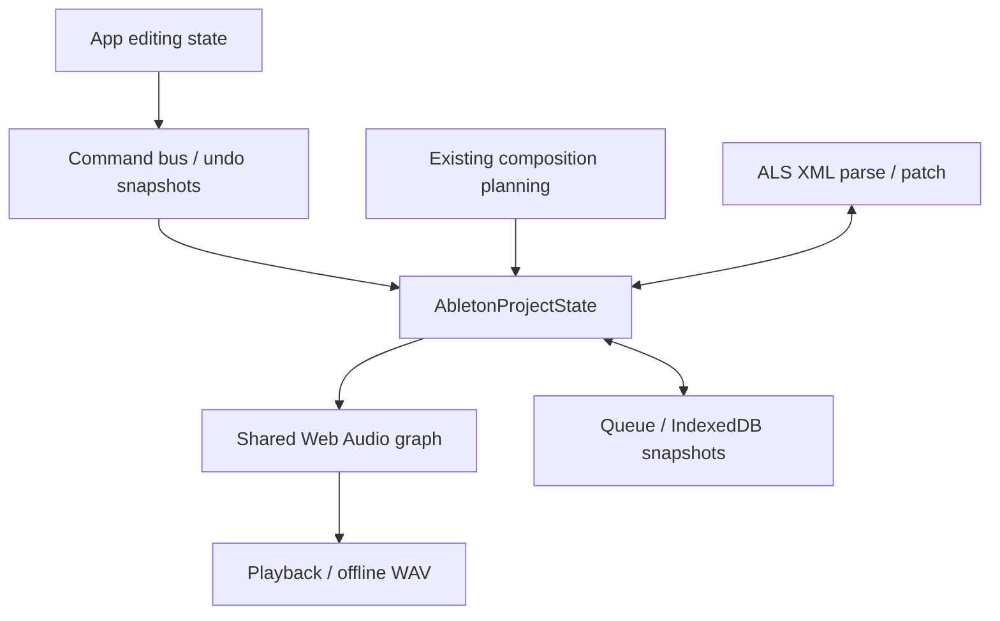
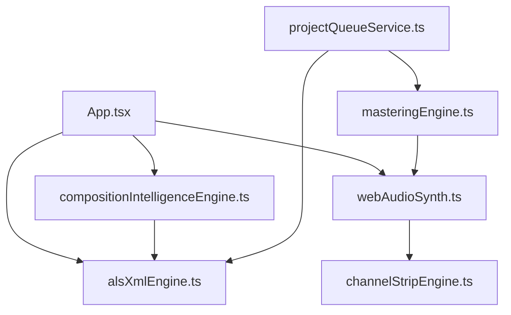

# Core refinement baseline — 2026-11-02

Source baseline: `31d0974e18ac0038db8a895fcac94e3fca8bfacf`. This assessment precedes corrective changes. Existing historical audit documents are not current acceptance evidence.

## G0 inventory and ownership

| Boundary | Current implementation | Finding |
|---|---|---|
| Domain | `types/ableton.ts`, `AbletonProjectState` | Typed tracks/clips/notes, float beats; no complete tempo/meter maps, migration contract, asset hash index or device parameter identities |
| Composition | `compositionIntelligenceEngine.ts`, `TechnoHeuristicEngine` in `alsXmlEngine.ts` | Existing heuristic XML injection plus conditioned layer planning; retain both existing roles, introduce no competing engine |
| Timeline | `TimelineCanvas.tsx`, `timelineViewportController.ts`, editing functions in composition module | Independent clip arrays and edits exist; mixed short clips and import timing need regression evidence |
| Audio/render | `webAudioSynth.ts`, `channelStripEngine.ts`, `masteringEngine.ts` | Production live/offline share voice/insert graph; waveform fixture synthesizer is separate and must not become export fallback |
| Interoperability | `alsXmlEngine.ts`, `alsPatchEngine.ts` | Raw XML snapshots preserve otherwise uninterpreted state; replacement of clip nodes loses metadata; semantic timing fidelity not certified |
| Persistence/history | `projectQueueService.ts`, `commandBus.ts` | Queue snapshots, IndexedDB writes, per-key history; active App state is another editable owner; no complete recovery/load guarantee |
| UI | `App.tsx`, Timeline, DeviceRack, SoundCraft mixer/workstation | Mix of command transactions and direct state updates; undo coverage incomplete |
| Android | `fileExportService.ts`, native FileExportPlugin, Gradle and android-debug workflow | SAF chunk/write/reopen verification implemented; existing workflow includes browser audio tests; physical qualification absent |

## Baseline execution

- PASS: `npm ci --no-audit --no-fund`.
- PASS: `npm test -- --reporter=json --outputFile=/tmp/aidaw-baseline-tests.json`: 69/69.
- PASS: `npm run lint`.
- PASS: `npm run build`. Bundle warning: JS chunk ~894 kB minified; not a performance pass.
- NOT TESTED at baseline: physical Android, listening, real-time/offline parity, full ALS fixtures, 200-project musical review, memory/performance qualification.

## Canonical contract and duplicate owners

Current compatibility contract uses absolute arrangement beats for `MidiNoteEvent.time` and `quantizedTime`, and absolute clip start/end. `clip.length` is the editable extent. All editing/rendering must honor those coordinates; do not introduce another timeline. XML remains a serialization/preservation representation, not authority for silently replacing UI edits. Current raw XML, typed state, queue snapshots and transport length can diverge. Every relevant correction must test typed state → XML → parsed state.

The required integer-tick/tempo-map domain migration is **BLOCKED** pending a separate ADR and migration fixtures. No new authoritative model is introduced by this milestone. General ALS clip-local note mapping, loop expansion, audio regions, tempo maps and Session/Arrangement transitions still need explicit semantics.

## Root-cause investigation before composition changes

| Investigation | Evidence / status |
|---|---|
| Hardcoded initialization | CONFIRMED: App New Project invokes `buildStarterAbletonXml('berghain-134', seed)` without duration; builder defaults to 16 bars and emits kick every beat |
| Fixed templates | CONFIRMED: default six section roles, one optional extra-drop branch; form mostly affects opening, not a complete harmonic/form plan |
| Reused seeds | Fresh UI random seed exists; CONFIRMED stale composition/jitter state after New Project, distinct from accidental reuse of starter random seed |
| Constant harmony | CONFIRMED limited strategy scales, fixed rhythmic cells/voicing and bar-modulo pitch movement; not advanced harmonic planning |
| Shared clip arrays | NOT CONFIRMED: no evidence yet of cross-track aliasing as root cause |
| Defaults overriding decisions | CONFIRMED: parser initializes max end to 64 beats, clamps clip lengths to >=4 beats; short projects/clips gain silent extent |
| UI discards generation | CONFIRMED metadata inconsistency: analysis regenerates sections with seed 0 unless generation identity exists; full-generation handler flattens composed notes into one clip |
| Timing normalization | CONFIRMED short clip clamp; phrase alignment of weighted section lengths is not guaranteed |
| Renderer unintended loops | NOT CONFIRMED as cause of repetition; current scheduling checks clip containment; imported loop semantics remain unverified |
| Export differs from editor | CONFIRMED serializer replaces all arrangement MIDI clip nodes, changes IDs and drops unknown clip structures; full-generation clip boundaries flattened. General audio parity NOT TESTED |

## G0 decision

PASS for executable baseline, inventory, diagrams, current contract, state-owner identification and reproducible source-level defects. This is permission to make incremental corrections, **not** approval of the current architecture as core-complete. Major engine rewrite remains prohibited. G1–G7 are not passed.
