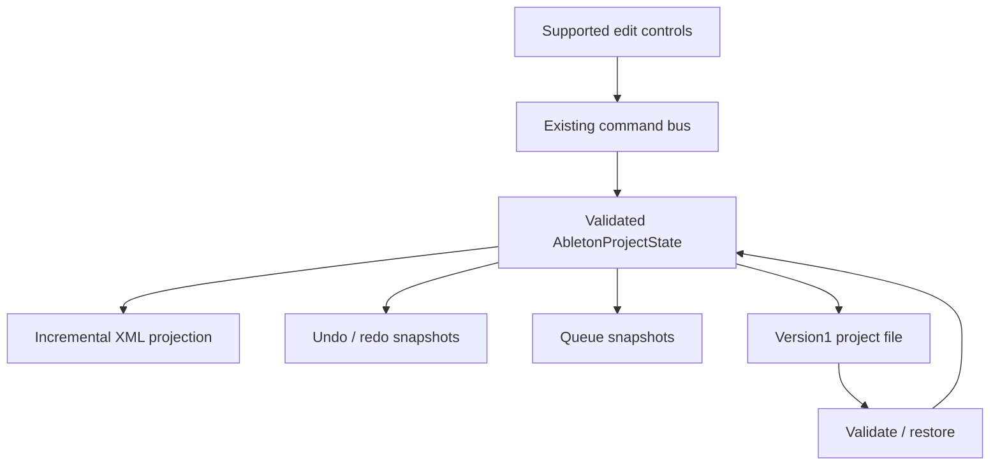

# Milestone2 — G1 state integrity, persistence and timeline boundaries

Source baseline: M1 commit `33bc0b62ef0e1c90775df6021cfafc7932aab285`, merged by PR4 into main `e77105c4decbb49cbc6d7d86873d50358ed140fe` during this work. Its tree matches the local M1 baseline. Corrective commit: report-containing commit / PR head. No engine replacement or composition expansion.

## Updated baseline evidence

M1 CI run [41367001458](https://github.com/dejayillegal/aidaw/actions/runs/41367001458) PASS:78 tests, Chromium rendering/responsive checks, Android SDK/Gradle build, APK verification and checksum creation. `m1-ci-evidence.json` contains measured records retrieved from job125029163328 logs.

The64-bar44.1kHz24-bit fixture produced5,297,151 frames /120.116802721s including8s tail,31,782,950 bytes, sample peak0.890816927, and non-silent final musical quarter. Eight short repeats stayed within the existing max0.001/RMS0.0001 tolerance. This removes the former executable-browser/SDK blocker for that automated subset. It does **not** establish live/export capture parity, true-peak/DC/stereo/low-end qualification, human listening, physical Android usability or release acceptance.

## Data flow / state ownership

Typed state is the editable authority for the corrected paths. XML is a supported-field serialization plus opaque preservation representation. The new state-contract and coordinate modules are stateless helpers; they do not own project state or schedule sound. Existing gaps and direct mutation paths are not described as converged.

## Root causes, changes and requirement traceability

| ID / requirements | Source/function | Reproduction; baseline failure | Correction / regression | Status |
|---|---|---|---|---|
| S01 / §2.2,3.1,6 | commandBus.executeMutation; alsXmlEngine.synchronizeProjectStateToXml | Move a note via typed-state mutator and reparse exported XML: old onset remains | Validate and sync changed MIDI content at transaction boundary; note-move→XML→reload→undo/redo test | PASS automated |
| S02 / §2.2,3.2 | syncLocatorsAndMixerToXml; parseAbletonXmlDom | Edit mixer, mute/solo/lock, energy envelope, tempo,192-bar sparse extent; reload resets values | Versioned app metadata, scalar tempo and explicit extent projection; precise reload assertions | PASS app subset; native Live interpretation NOT TESTED |
| S03 / §3.1,6 | same locator serializer/parser | Remove the final locator: stale marker remains | Serialize explicit empty list; preserve opaque clip XML on unrelated edits | PASS |
| S04 / §9 | projectStateContracts.assertProjectState; existing command bus | NaN pan enters history instead of rejection | Validate before committing; rejected edit leaves input/history unchanged | PASS |
| S05 / §2.2,3.1 | App.handleExecuteProjectCommand and supported mixer/automation/mute/solo/tempo/extent/lock/note callbacks | Side effects in state updaters risk duplicate transactions under StrictMode; direct controls bypass history | Ordered existing bus outside state updater; actual StrictMode UI asserts one mute transaction and preserved history | PASS tested controls; remaining direct paths incomplete |
| S06 / §2.2,6 | projectSnapshotService; App save/open callbacks; StudioMenuBar | ALS-only persistence does not retain full app editing/audio state | Version1 file stores existing project/settings and original XML; actual save→new→open UI, exact track/take/device state, future-version rejection | PASS local automated; physical destination verification NOT TESTED |
| S07 / §3.4 | timelineCoordinates; webAudioSynth.getCurrentBeat, runLookaheadScheduler, runVisualPlayheadLoop | Loop starts at beat12, requested span64, song ends20: scheduler uses requested instead of actual8-beat span; non-loop getter uses modulo | One region/wrap calculation, long-repeat and existing-engine getter regressions | PASS clock/scheduler contracts |
| S08 / §3.4,5.1 | same lookahead scheduler | Crossing loop clears prepaid next-cycle note keys; delayed ticks count only one skipped cycle | Keep current-generation keys, retire expired keys, advance all skipped cycles; actual scheduler tests | PASS unit; live PCM capture NOT TESTED |
| S09 / §3.4,5.4 | timelineCoordinates.noteIsInsideClip; live/offline scheduling | Live expands0.125-beat clip to0.25; offline honors actual length | Shared exact half-open eligibility; sub-quarter bounds test | PASS unit; browser fixture gate remains required |
| S10 / §3.4 | commandBus.applyClipPositionWithEditMode; coordinate defaults | Move0.125-beat clip without endTime: inferred duration becomes16; fine note grid is rounded to quarters; long defaults cap at512/2048 | Use explicit clip.length, preserve grid displacement, remove implicit edit/automation default ceilings; round-trip movement tests | PASS |
| S11 / §3.1 | TimelineCanvas / SoundCraft callback contract; App note handler | Note editing assumes clip index0 | Pass clip identity through existing callback and resolve containing clip | PASS compilation/integration wiring; dedicated pointer gesture qualification NOT TESTED |
| S12 / §5.3,6 | parseAbletonXmlDom native automation handling | Unrelated native Hz/dB/target events flattened into normalized browser energy curve | Preserve native envelopes opaque; emit explicit warnings;20000-Hz fixture remains intact while app curve stays normalized | PASS preservation subset |
| S13 / U01,§5.4 | tests/recovery-browser.html; recovery-browser-check.mjs | Parsed probability changes require actual native-render regression | Offline44.1/48kHz PCM vs explicit eligible-event oracle for0/1/fractional probabilities; hardcoded eligible IDs and finite/non-silent/error bounds | NOT TESTED locally; CI executes on this revision |

Initial S01–S04 run:4/4 failed before correction. Current automated results are in `evidence.json`. Source inventory includes the functions above plus new stateless project-state validation/timeline helpers and regression tests. ADR-002 documents migration, rollback and explicit bounds. Existing Android save/signing implementations were not changed.

## Acceptance ledger

| Gate | Status | Remaining critical work |
|---|---|---|
| G0 | PASS | M1 baseline retained; updated evidence/source assessment here |
| G1 | FAIL | Integer ticks, tempo/meter maps and their playback/render integration; complete command coverage; routing validation; new-track/device native materialization; Session state transitions; persistence/recovery stress and asset integrity |
| G2 | NOT TESTED | Original requirement remains200 complete projects across seeds/styles/durations, quantitative diversity and listening; no100-plan substitute |
| G3 | NOT TESTED | Complete variable-duration tracks, intentional endings, independent development and transition/drop contrast |
| G4 | NOT TESTED | Full gate unqualified. M1 Chromium subset PASS; M2 native probability oracle awaits CI; live capture parity/listening and complete quality measurements absent |
| G5 | FAIL | Native parameter/device/routing/tempo/group/audio/expression fixtures and verified Live round trips missing; app metadata is not universal Ableton execution |
| G6 | BLOCKED | Physical Android installation, editing, long export, memory, lifecycle, foldable/orientation and external-player qualification required; SDK build previously PASS |
| G7 | BLOCKED | Upstream gates, signing lineage/install/upgrade and owner acceptance remain required |

## Compatibility, performance and release risks

- `.aidaw.json`: native app project/settings preservation, including full typed device/take state and original XML. Does not embed audio assets or undo stacks; does not establish IndexedDB recovery or atomic background autosave.
- ALS: targeted MIDI/scalar/project metadata round trip. Browser mixer and normalized energy lane are app metadata with explicit parameter identity, **not** verified native Live mixer/device automation. Arbitrary native automation is retained opaque with a warning. Unknown clip structures are kept on unrelated edits; edited Notes/KeyTracks and locator structures still need broader preservation fixtures.
- Timing: absolute beats remain the current compatibility contract. No integer-tick or tempo/meter-map completion is claimed. Invalid/outside-song loop ranges currently fall back to non-loop behavior; explicit loop-range UX/rejection still needs work.
- Editing: covered controls now transact. Master-bus controls, device edits, velocity/grid humanization, some generation and Session operations still need complete history/state integration. Native project persistence preserves their typed state but does not prove ALS device execution fidelity.
- Performance/memory: NOT TESTED as a sustained device qualification. Existing256MiB render preflight remains; no streaming renderer introduced. Test timings/build size are not real-time audio CPU/RSS benchmarks.
- Audio/listening: M1 measured records supplied; M2 browser oracle is an offline event-interpretation regression, not a live capture comparison or producer listening approval. No commercial release-quality claim.

New Project still creates a16-bar starter. Composition planning/harmony expansion remains deferred while G1 is FAIL. This milestone advances G1 without changing the product acceptance contract or declaring core completion.
